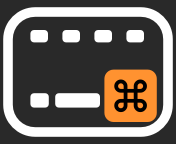
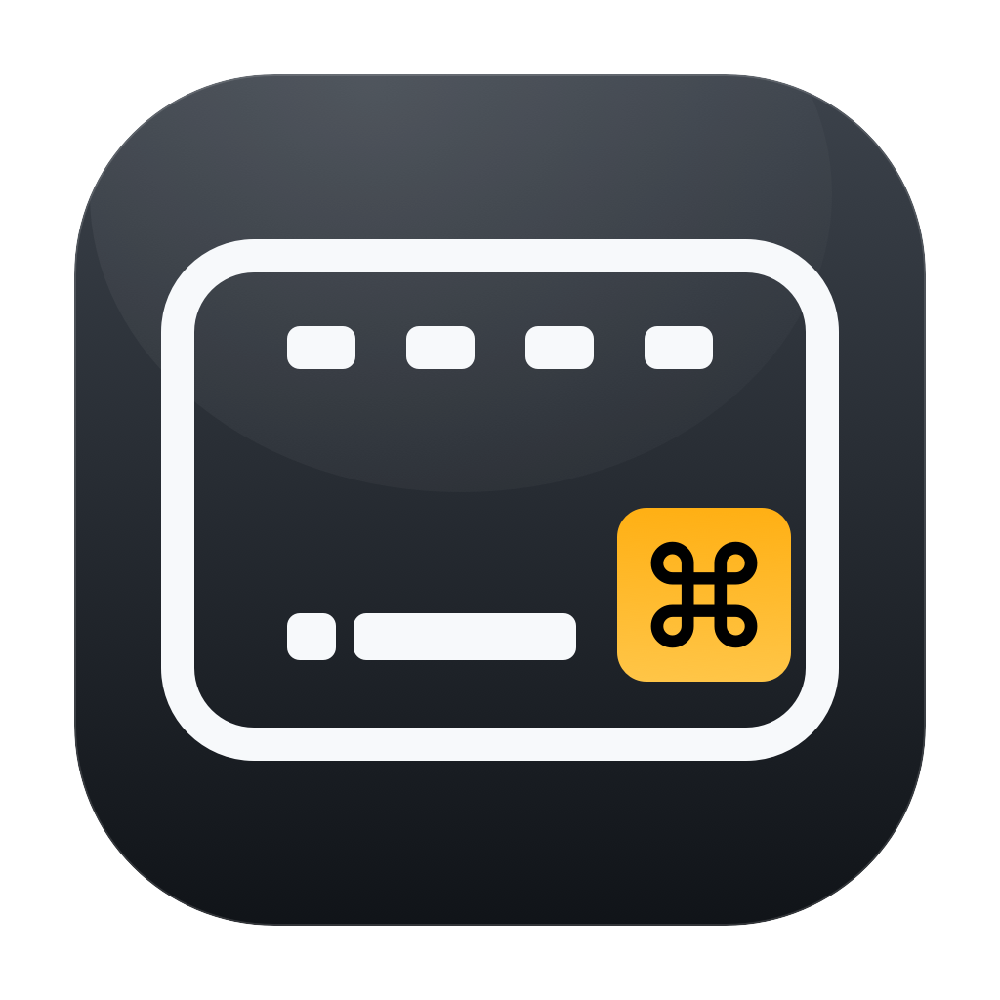

# K3 Battery Bar

一个面向 macOS 的 Keychron K3 蓝牙电量菜单栏工具。它直接读取键盘的
HID `Report ID 3`，不需要连接 USB。

> 非官方项目，与 Keychron 没有隶属关系。

菜单栏只显示一个键盘图标，通过 Command 键的颜色表达电量区间：



- 图标采用接近正方形的 22×18 比例
- 顶部四个小键和底部空格键只用于保留键盘识别特征
- 放大的 Command 键是唯一彩色焦点
- 绿色：61–100%
- 橙色：21–60%
- 红色：0–20%
- 灰色轮廓：键盘未连接或暂不可读

菜单、提示文字和 macOS 辅助功能描述仍提供精确百分比。

App Bundle 同时包含从 16px 到 1024px 的 `AppIcon.icns`，用于 Finder、
Spotlight 和启动器。



当前实现参考了以下开源项目的协议发现与产品行为：

- [rxrdev/keychron-battery-level](https://github.com/rxrdev/keychron-battery-level)（MIT）
- [sebflorent/keychron-battery-monitor](https://github.com/sebflorent/keychron-battery-monitor)（MIT）
- [LokHsu/keychron-k3-battery-sync](https://github.com/LokHsu/keychron-k3-battery-sync)
  （只参考公开说明和 API 行为，未复制其未声明许可证的代码）

本项目自身采用 MIT 许可证；第三方归属信息见
[THIRD_PARTY_NOTICES.md](THIRD_PARTY_NOTICES.md)。

## 功能

- 菜单栏只显示一个键盘图标，通过 Command 键颜色区分电量区间
- 显示设备蓝牙地址和更新时间
- 默认每 30 秒刷新
- 键盘未连接、权限缺失时显示明确状态
- 不修改键盘配置，不依赖私有 IOKit SPI

## 实测数据

在这台 Mac 上读取到的原始报告为：

```text
03 32 AA BB CC DD EE FF
```

- `03`：HID Report ID
- `32`：十六进制电量，即 50%
- `AA:BB:CC:DD:EE:FF`：键盘蓝牙地址（示例）

HID 描述符把 `Report ID 3` 定义为 Generic Device Controls /
Battery Strength（Usage Page `0x0006`，Usage `0x0020`），逻辑范围
`0...100`。

## 构建与测试

要求 macOS 13 或更高版本，以及完整 Xcode 工具链。

```bash
swift test
swift run k3-battery
```

构建可双击运行的菜单栏应用：

```bash
./scripts/build-app.sh
open dist/K3BatteryBar.app
```

## 输入监控权限

macOS 对外部 HID 报告实施 TCC 权限控制。首次启动后，在：

```text
系统设置 → 隐私与安全性 → 输入监控
```

允许 `K3BatteryBar`，必要时重启应用。权限只用于读取 K3 的 HID 报告，
本项目不记录按键内容。

本地构建采用 ad-hoc 签名；重新构建后 macOS 可能把它视为新的程序，
需要重新授权。构建脚本会自动检测本机 `Developer ID Application` 或
`Apple Development` 身份；也可以通过 `CODE_SIGN_IDENTITY` 显式指定。
公开发布签名和 notarization 流程见 [docs/SIGNING.md](docs/SIGNING.md)。

如果菜单显示“未连接”，先检查键盘是否在蓝牙模式下连接。如果显示
“需要输入监控权限”，直接使用应用菜单中的权限入口。也可以从终端检查：

```bash
dist/K3BatteryBar.app/Contents/MacOS/K3BatteryBar --diagnose
```

需要主动触发应用的权限请求时：

```bash
dist/K3BatteryBar.app/Contents/MacOS/K3BatteryBar --diagnose --request-access
```

把当前键盘图标放大导出为 PNG，便于调整视觉细节：

```bash
dist/K3BatteryBar.app/Contents/MacOS/K3BatteryBar --render-icon /tmp/k3-icon.png
```

## 已知限制

- 目前按产品名 `Keychron K3` 和 Bluetooth Transport 匹配设备
- 只能读取电量百分比，不能读取真实充电状态
- 菜单栏显示不进入系统“电池小组件”；后者需要私有 IOKit SPI，因此未采用
- 如果 Karabiner Elements 等工具独占 HID 设备，可能读取失败

## 为什么 Linux 能直接显示

Linux 内核启用 `CONFIG_HID_BATTERY_STRENGTH` 后，会把 K3 的 Battery
Strength HID 字段注册成 `power_supply` 设备，UPower 和桌面环境即可
直接显示。macOS 接收了同样的报告，但不会自动把第三方 Bluetooth Classic
HID 电量注册到系统电池面板，因此需要本工具主动读取。
